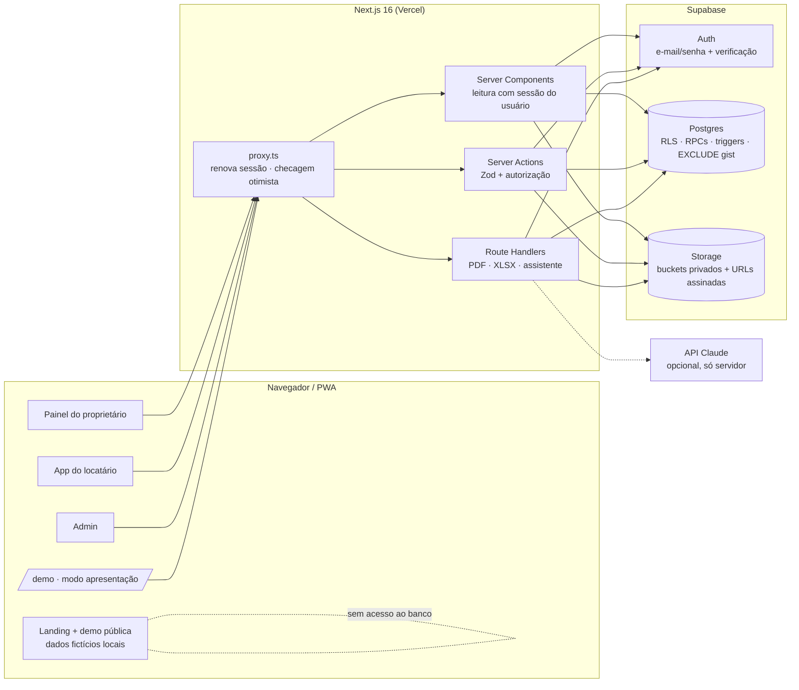
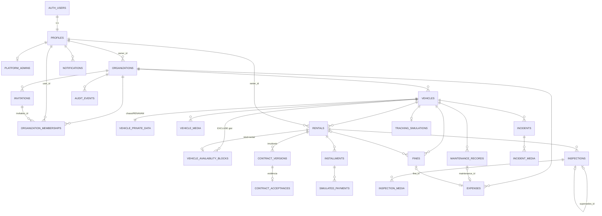
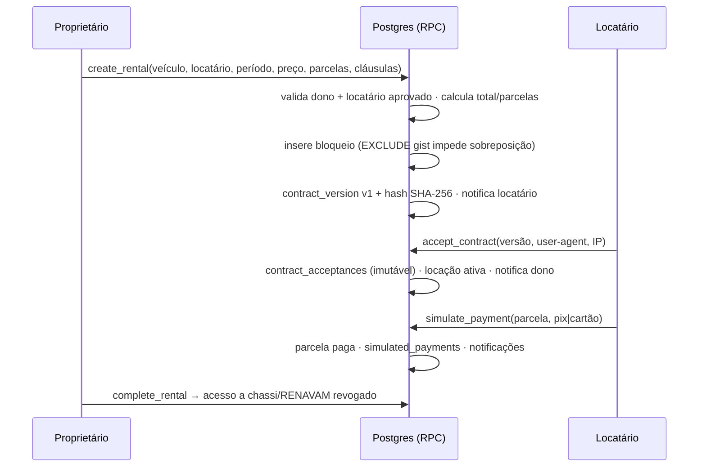

# Arquitetura do MOVIX

## Visão de componentes

- **Leitura**: Server Components usam o cliente Supabase com os cookies do usuário (`src/lib/supabase/server.ts`). A RLS decide o que retorna.
- **Escrita**: Server Actions (`src/features/*/actions.ts`) validam com Zod e chamam tabelas (CRUD simples protegido por RLS) ou RPCs `SECURITY DEFINER` para fluxos atômicos (criar locação, aceitar, pagar, revisar vistoria, aprovar vínculo, admin).
- **Contexto de locadora**: cookie `movix_org`, sempre validado contra os vínculos aprovados do usuário (`src/lib/auth/context.ts`). Triggers derivam `organization_id` de `vehicle_id`/`rental_id` — o browser nunca define o escopo.
- **Service role**: usada apenas no script de seed (`supabase/seed/seed.ts`) e nos testes E2E. O app não depende dela.

## Modelo de dados (ER)

Migrations: `supabase/migrations/` — `0001_schema` (tabelas, constraints, índices, triggers de escopo), `0002_security` (helpers, grants por coluna, RLS), `0003_functions` (RPCs, notificações, auditoria), `0004_storage` (buckets e políticas), `0005_demo` (povoamento sintético idempotente).

## Fluxos principais

## Organização de pastas

| Caminho | Conteúdo |
|---|---|
| `src/app/(marketing)` | Landing, demo pública, termos, privacidade (tema escuro fixo) |
| `src/app/(auth)` | Login, cadastro, convite, recuperação de senha |
| `src/app/(owner)/painel` | Área do proprietário |
| `src/app/(renter)/app` | App do locatário (bottom nav) |
| `src/app/(admin)/admin` | Administração (agregados) |
| `src/app/demo` | Modo apresentação protegido |
| `src/app/api` | PDF de contrato, relatórios PDF/XLSX, assistente |
| `src/features/*` | Actions e componentes por módulo |
| `src/lib/domain` | Regras puras: preço, Health Score, insights, rastreamento, assistente |
| `src/lib/validation` | Zod + validações brasileiras |
| `src/lib/reports` | Motor de PDF |
| `tests/unit`, `tests/db`, `tests/e2e` | Vitest, PGlite (RLS), Playwright |
